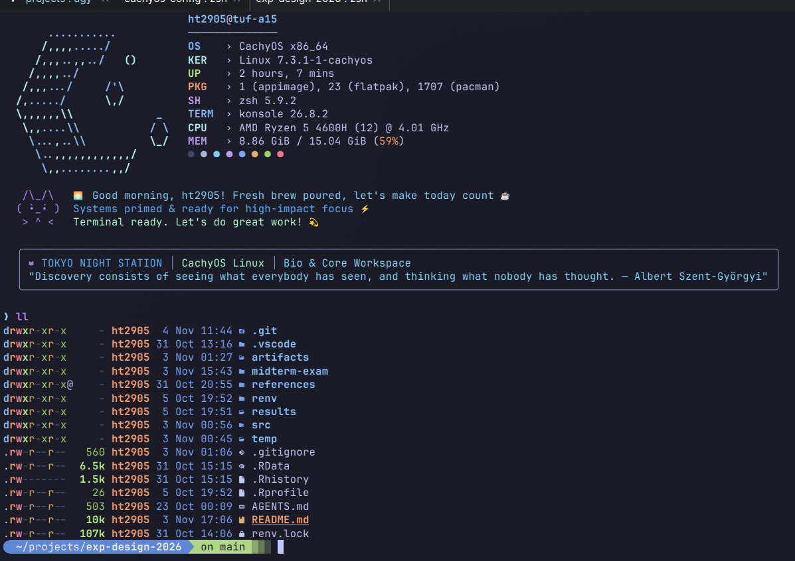
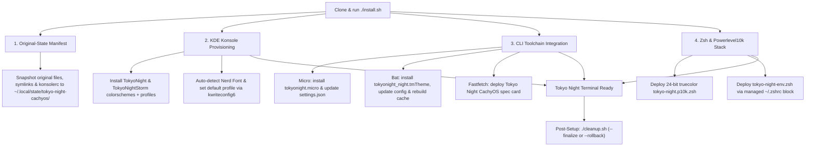

# Tokyo Night Customization Suite for CachyOS & KDE Konsole

A safe, turnkey terminal customization suite that applies a unified 24-bit truecolor Tokyo Night theme across KDE Konsole, Powerlevel10k, Zsh, Micro, Bat, Fastfetch, and FZF on CachyOS.



---

## Architecture & Workflow



---

## Features

- **Unified 24-Bit Truecolor Palette**: Consistent `#RRGGBB` Tokyo Night colors across Konsole, Powerlevel10k, Zsh syntax highlighting, Zsh autosuggestions, FZF, Micro, Bat, and Fastfetch.
- **Turnkey KDE Konsole Setup**: Installs both **Tokyo Night** (`#1a1b26`) and **Tokyo Night Storm** (`#24283b`) color schemes and profiles, auto-detects an installed Nerd Font, and activates `Tokyo Night` as the default profile via `kwriteconfig6`.
- **Safe, Non-Destructive Deployment**:
  - Preserves your **original** pre-install snapshot across repeated `install.sh` runs in `~/.local/state/tokyo-night-cachyos/`.
  - Unlinks existing symlinks after recording their targets so external dotfiles repositories are never mutated.
  - Uses strict `# >>> tokyo-night-cachyos >>>` / `# <<< tokyo-night-cachyos <<<` markers in `~/.zshrc`.
  - Gracefully skips any missing tool without running `sudo pacman`, printing a ready-to-run `pacman` command at the end.
- **Responsive Opening Greeting**: Fastfetch hardware overview, time-of-day ASCII cat greeting, and `$COLUMNS`-aware word-wrapped quote box wrapped in a local Zsh scope (zero global variable pollution).
  - Set `TOKYO_NIGHT_GREETING=0` in `~/.zshrc` to disable startup output.
  - Set `TOKYO_NIGHT_STATION_LABEL="Your Label"` to customize the quote box header.

---

## Quick Start

### 1. Install

```bash
git clone https://github.com/ht2905/tokyo-night-cachyos.git
cd tokyo-night-cachyos
chmod +x install.sh cleanup.sh
./install.sh
exec zsh
```

### 2. Finalize or Rollback

```bash
# Interactive menu:
./cleanup.sh

# Non-interactive CLI options:
./cleanup.sh --finalize  # Keep Tokyo Night active and remove backup snapshots
./cleanup.sh --rollback  # Restore exact pre-install files, symlinks & Konsole default
```

---

## Color Palette Reference

| Role | Color Name | Hex Code | Visual Tone |
| :--- | :--- | :--- | :--- |
| **Background (Night)** | Deep Midnight | `#1a1b26` | Dark navy / indigo |
| **Background (Storm)** | Dark Slate | `#24283b` | Medium midnight slate |
| **Surface** | Elevated Indigo | `#3b4261` | Subtle UI surface |
| **Muted / Comments** | Comment Slate | `#565f89` | Comments & autosuggestions |
| **Foreground** | Soft Ice White | `#c0caf5` | High-readability foreground |
| **Accent / Directory** | Neon Indigo | `#7aa2f7` | Crisp terminal blue |
| **VCS Clean** | Mint Green | `#9ece6a` | Git clean status & strings |
| **VCS Modified** | Warm Amber | `#e0af68` | Git modified & flags |
| **Prompt / Command** | Cyan Spark | `#7dcfff` | Commands & prompt symbol |
| **Highlight / Special** | Vivid Lavender | `#bb9af7` | FZF highlight & keywords |
| **Error / Conflict** | Coral Red | `#f7768e` | Errors & merge conflicts |

---

## Repository & Deployment Layout

| Subsystem | Source Path | Target Location |
| :--- | :--- | :--- |
| **Installer & Rollback** | `install.sh`, `cleanup.sh` | Manifest state in `~/.local/state/tokyo-night-cachyos/` |
| **KDE Konsole** | `themes/konsole/` | `~/.local/share/konsole/` + `konsolerc` |
| **Powerlevel10k** | `themes/zsh/tokyo-night.p10k.zsh` | `~/.p10k.zsh` |
| **Zsh Environment** | `themes/zsh/tokyo-night-env.zsh` | `~/.config/zsh/tokyo-night-env.zsh` (sourced from `~/.zshrc`) |
| **Micro Editor** | `themes/micro/tokyonight.micro` | `~/.config/micro/colorschemes/` + `settings.json` |
| **Bat Pager** | `themes/bat/tokyonight_night.tmTheme` | `$(bat --config-dir)/themes/` + `config` |
| **Fastfetch** | `themes/fastfetch/config.jsonc` | `~/.config/fastfetch/config.jsonc` |

---

## System Requirements

- **Distribution**: CachyOS, Arch Linux, or any Linux distribution running KDE Plasma 6.
- **Core Packages**: `zsh`, `konsole`, `micro`, `bat`, `fastfetch`, `fzf`, `zsh-theme-powerlevel10k`.
- **Font**: Any Nerd Font (e.g., `ttf-meslo-nerd`, `ttf-jetbrains-mono-nerd`, `ttf-firacode-nerd`).
