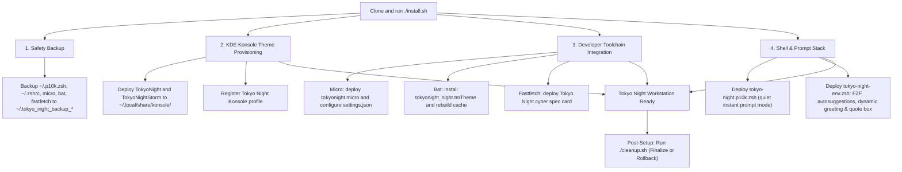

# Tokyo Night Customization Suite for CachyOS and KDE Konsole

A tailored, turn-key terminal customization suite engineered to transform a CachyOS workstation into a unified, cyber-indigo development environment. Fully integrates KDE Konsole, Powerlevel10k, Micro, Bat, Fastfetch, and FZF.


---

## Architecture and Workflow



---

## Features

- **Unified Tokyo Night Design**: Synchronizes color schemes across terminal emulators, code editors, CLI pagers, and system fetch cards.
- **KDE Konsole Dual Profiles**:
    - **Tokyo Night**: Classic midnight indigo (`#1a1b26`) for optimal dark-mode contrast.
    - **Tokyo Night Storm**: Slate storm background (`#24283b`) for medium-contrast preferences.
- **Editor and Pager Theming**:
    - Micro editor syntax coloring using `tokyonight.micro`.
    - Bat pager Sublime/TextMate theme (`tokyonight_night.tmTheme`) with automatic cache compilation via `bat cache --build`.
- **Fastfetch Hardware Card**: Cyber-minimalist system spec layout customized with CachyOS branding and indigo/cyan highlights.
- **Dynamic Terminal Greeting & Wisdom Box**:
    - Automatic system spec overview via Fastfetch on interactive launch.
    - Time-of-day greeting (morning, afternoon, evening, quiet hours) with ASCII cat companion and user attribution.
    - Curated 20-quote authenticated wisdom and science quotes array spanning bioinformatics, computing, and mathematics with dynamically calculated border alignment.
- **Powerlevel10k Prompt**: Configured with segmented pill shapes, blurred pill transitions, execution timers, git status colors (clean mint, modified amber), one-line transient prompt mode, and quiet instant prompt mode (`POWERLEVEL9K_INSTANT_PROMPT=quiet`) eliminating console output alerts while preserving sub-millisecond launch speed.
- **Safe Rollback Utilities**: Automated pre-execution snapshot to `~/.tokyo_night_backup_*` with complete one-command restore capabilities.

---

## Quick Start

### 1. Installation
Clone the repository and run the setup script:

```bash
git clone https://github.com/<username>/tokyo-night-cachyos.git
cd tokyo-night-cachyos
chmod +x install.sh cleanup.sh
./install.sh
```

### 2. Apply in Konsole
1. Open **Konsole**.
2. Navigate to **Settings** > **Manage Profiles...**
3. Select **Tokyo Night** from the profiles list.
4. Click **Set as Default** and press **OK**.
5. Reload shell:
    ```bash
    exec zsh
    ```

### 3. Post-Setup Management
Run the cleanup utility when you have verified your workstation:

```bash
# Interactive menu:
./cleanup.sh

# Non-interactive CLI options:
./cleanup.sh --finalize    # Retain Tokyo Night configuration and remove backup folder
./cleanup.sh --rollback    # Restore original shell, editor, and Konsole settings
./cleanup.sh --delete-only # Delete backup folder while retaining Tokyo Night settings
```

---

## Color Palette Reference

| Role | Color Name | Hex Code | Visual Tone |
| :--- | :--- | :--- | :--- |
| **Background (Night)** | Deep Midnight | `#1a1b26` | Dark navy / indigo |
| **Background (Storm)** | Dark Slate | `#24283b` | Medium midnight slate |
| **Foreground** | Soft Ice White | `#c0caf5` | High-readability white |
| **Accent / Directory** | Neon Indigo | `#7aa2f7` | Crisp terminal blue |
| **VCS Clean** | Mint Green | `#9ece6a` | Git clean status |
| **VCS Modified** | Warm Amber | `#e0af68` | Git modified / untracked |
| **Prompt Symbol** | Cyan Spark | `#7dcfff` | Execution indicator |
| **Highlight / Special** | Vivid Lavender | `#bb9af7` | FZF pointer and Micro keywords |

---

## Repository Components

| File | Target Location | Description |
| :--- | :--- | :--- |
| [`install.sh`](install.sh) | Current Folder | Automated deployment script for Konsole, Bat, Micro, Fastfetch, and Zsh |
| [`cleanup.sh`](cleanup.sh) | Current Folder | Safety rollback and backup directory management utility |
| [`TokyoNight.colorscheme`](TokyoNight.colorscheme) | `~/.local/share/konsole/` | Native KDE Konsole color scheme for Tokyo Night (`#1a1b26`) |
| [`TokyoNightStorm.colorscheme`](TokyoNightStorm.colorscheme) | `~/.local/share/konsole/` | Alternate storm variant with lighter slate background (`#24283b`) |
| [`tokyo-night.p10k.zsh`](tokyo-night.p10k.zsh) | `~/.p10k.zsh` | Powerlevel10k theme configuration with quiet instant prompt and styled pills |
| [`tokyonight.micro`](tokyonight.micro) | `~/.config/micro/colorschemes/` | Syntax highlighting definition for Micro editor |
| [`tokyonight_night.tmTheme`](tokyonight_night.tmTheme) | `$(bat --config-dir)/themes/` | Sublime/TextMate syntax theme for `bat` pager |
| [`fastfetch.jsonc`](fastfetch.jsonc) | `~/.config/fastfetch/config.jsonc` | Minimalist system specification card with Tokyo Night palette |
| [`tokyo-night-env.zsh`](tokyo-night-env.zsh) | `~/.config/zsh/` | Environment hooks: FZF palette, autosuggestions, dynamic greeting & quote box |
| [`assets/`](assets/) | Media Assets | Workstation demonstration screenshots and visual previews |

---

## System Requirements

- **Distribution**: CachyOS, Arch Linux, or any Linux distribution running KDE Plasma (version 5 or 6).
- **Core Packages**: `zsh`, `konsole`, `micro`, `bat`, `fastfetch`, `fzf`.
- **Font**: Nerd Font (such as MesloLGS NF, JetBrainsMono NF, or Hack NF) configured in Konsole profile settings.
