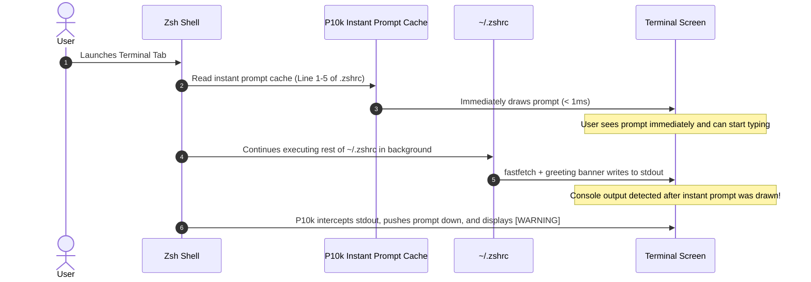

# Powerlevel10k Instant Prompt & Console Output Guide

## Why Did This Warning Appear?

When you open a terminal with Powerlevel10k, you encounter this notice:

```text
[WARNING]: Console output during zsh initialization detected.
When using Powerlevel10k with instant prompt, console output during zsh initialization may indicate issues.
```

### The Root Cause: How Instant Prompt Works

Powerlevel10k uses an optimization technique called **Instant Prompt**:



1. **Immediate Rendering:** Lines 1–5 of your `~/.zshrc` execute the `p10k-instant-prompt` preamble. This draws a cached prompt at the top of your terminal window in under 1 millisecond.
2. **Background Execution:** While you see the prompt and can type commands, Zsh continues sourcing the rest of your `~/.zshrc` (loading plugins, completions, aliases, and functions).
3. **Console I/O Interception:** When `~/.zshrc` reaches `fastfetch` and the `echo` commands of your greeting sequence, it outputs text to the screen.
4. **The Alert:** Powerlevel10k expects `~/.zshrc` to produce zero console output. In default `verbose` mode, it treats any console output as a potential error or misconfiguration (e.g., an errant script printing warnings), so it wraps the output in an explicit warning block.

---

## Solutions Comparison

| Method | Behavior | Startup Speed | Visual Result | Recommended For |
| :--- | :--- | :--- | :--- | :--- |
| **1. `quiet` mode** | Suppresses the warning; keeps instant prompt caching active | Blazing fast ($< 1\text{ms}$) | Banner prints, prompt sits cleanly beneath it | **Recommended:** Keeps P10k speed with intentional banners |
| **2. `off` mode** | Disables instant prompt completely | Fast ($20\text{--}30\text{ms}$ on CachyOS) | Clean linear flow: system fetch $\to$ banner $\to$ prompt (no jump) | Users who dislike prompt re-drawing |
| **3. Pre-prompt Hook** | Defers banner until the first prompt cycle | Standard instant prompt | First command cycle triggers the banner | Complex scripting environments |

---

## How to Fix It

### Solution 1: Switch Instant Prompt to `quiet` (Recommended)

This tells Powerlevel10k: *"I know my `~/.zshrc` intentionally produces console output (my greeting banner). Please display the output without the warning box."*

#### Method A: Update in `~/.p10k.zsh`
Open your tracked configuration file:
- File: [`/home/ht2905/cachyos-config/configs/.p10k.zsh`](file:///home/ht2905/cachyos-config/configs/.p10k.zsh#L1822) (line 1822)

Locate:
```zsh
typeset -g POWERLEVEL9K_INSTANT_PROMPT=verbose
```

Change it to:
```zsh
typeset -g POWERLEVEL9K_INSTANT_PROMPT=quiet
```

#### Method B: Set in `~/.zshrc`
Alternatively, you can define it right before the instant prompt preamble at the very top of [`configs/.zshrc`](file:///home/ht2905/cachyos-config/configs/.zshrc):

```zsh
# Suppress instant prompt warning for intentional greeting banner
typeset -g POWERLEVEL9K_INSTANT_PROMPT=quiet

# Enable Powerlevel10k instant prompt.
if [[ -r "${XDG_CACHE_HOME:-$HOME/.cache}/p10k-instant-prompt-${(%):-%n}.zsh" ]]; then
  source "${XDG_CACHE_HOME:-$HOME/.cache}/p10k-instant-prompt-${(%):-%n}.zsh"
fi
```

---

### Solution 2: Disable Instant Prompt (`off`)

If you prefer a strictly linear startup where nothing renders until `fastfetch` and your greeting finish printing, turn Instant Prompt off:

In [`configs/.p10k.zsh`](file:///home/ht2905/cachyos-config/configs/.p10k.zsh#L1822):
```zsh
typeset -g POWERLEVEL9K_INSTANT_PROMPT=off
```

> [!TIP]
> On CachyOS with Linux 7.3 and an AMD Ryzen processor, the total shell initialization time without instant prompt is typically under 30 milliseconds. The difference in human perception is negligible.

---

## Quick One-Command Fix

To apply **Solution 1 (`quiet`)** to your tracked dotfiles immediately, run:

```bash
sed -i 's/POWERLEVEL9K_INSTANT_PROMPT=verbose/POWERLEVEL9K_INSTANT_PROMPT=quiet/' /home/ht2905/cachyos-config/configs/.p10k.zsh
```

Then launch a new terminal window or tab to verify that the warning is gone and the greeting displays cleanly.
